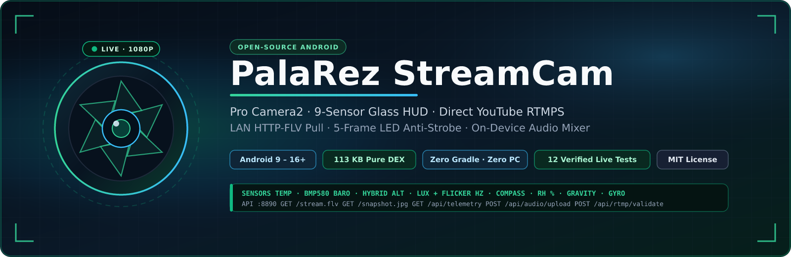
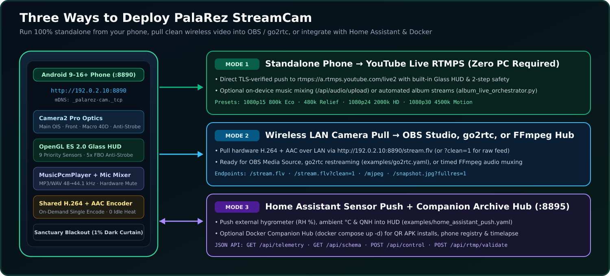
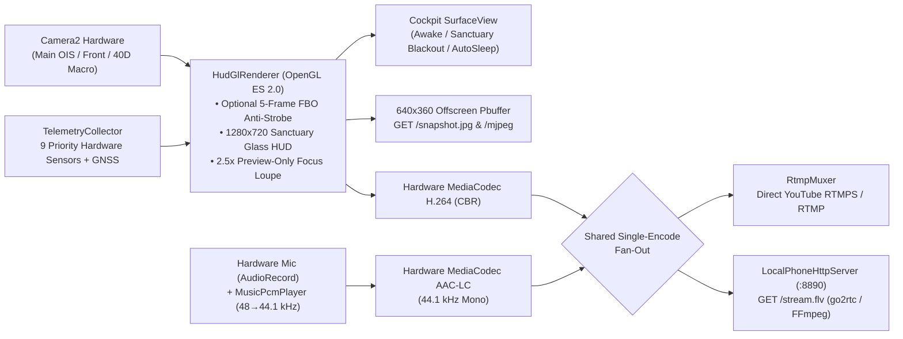
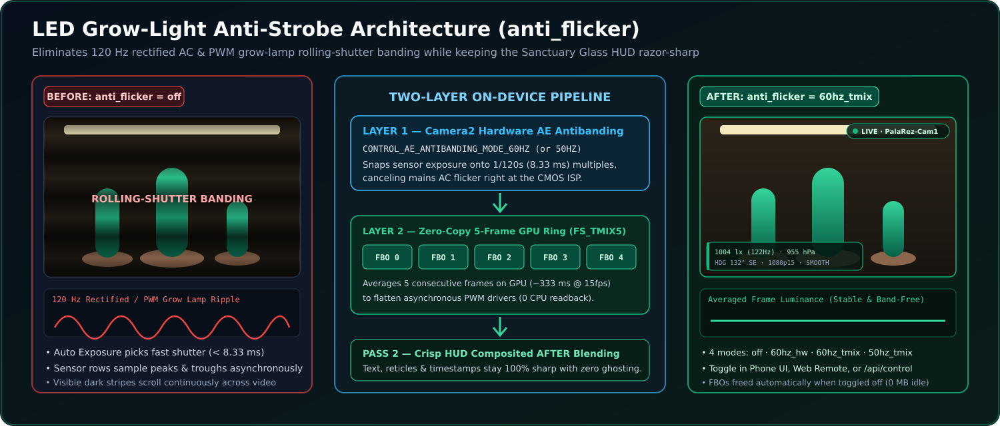
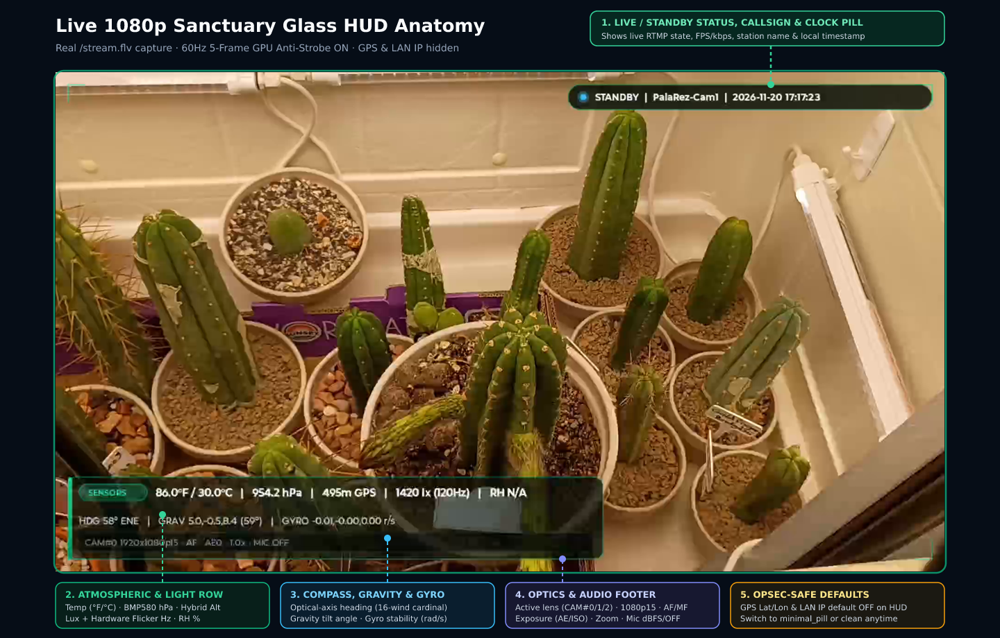
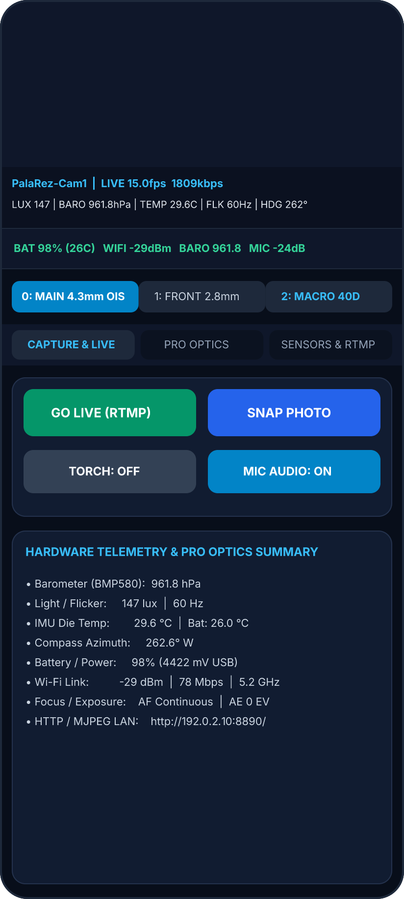

# PalaRez StreamCam (`palarez-cam`)

**Zero-Gradle Android Pro Camera2 + 9-Sensor Cyber-Flora Sanctuary Glass HUD + LAN HTTP-FLV Pull & Direct YouTube Live RTMP/RTMPS + On-Device Audio Mixer + Timelapse Platform** for Android 9–16+ (`minSdk 28`, `targetSdk 35`).

Run **100% standalone on an Android phone** streaming directly to YouTube Live over TLS (`rtmps://`), or pull a clean hardware-encoded H.264 + AAC mezzanine feed over LAN (`http://<PHONE_IP>:8890/stream.flv`) into `go2rtc`, `FFmpeg`, OBS, or MediaMTX.

---

## 3-Minute Quick Start (Prebuilt APK — No Coding or PC Required)

You do **not** need Android Studio, Gradle, or a computer to use PalaRez StreamCam. A signed, universal (`arm64` / `armv7` / `x86_64`, Android 9–16+) prebuilt APK is published on GitHub Releases (kept out of git history so the repository stays clean):

1. **Install on Your Phone**: Open **[Releases → Latest](https://github.com/chieftechnicalwizard/palarez-cam/releases/latest)** on your Android phone, download `palarez-cam.apk`, and tap to install (enable *"Install unknown apps"* for your browser when prompted).
2. **Grant Permissions**: Launch **PalaRez StreamCam** and allow **Camera**, **Microphone**, **Location** (optional, for GPS altitude/fix — GPS coordinates are **never** burned onto video unless you manually toggle them on), and **Notifications** (keeps the foreground broadcast alive 24/7).
3. **Mount & Frame**: Mount your phone **horizontally (landscape)**. Tap a lens pill (`0: MAIN`, `1: FRONT`, `2: MACRO`), double-tap the preview to check focus with the `2.5x` Focus Loupe, and if you are under **LED grow lights**, open **PRO OPTICS** and toggle **Reduce LED Strobe (`60Hz AE + 5-Frame Mix`)** ON.
4. **Add Your YouTube Stream Key & Test Safely**:
   * Open the **SENSORS & RTMP** tab.
   * Select **YouTube RTMPS (`rtmps://a.rtmps.youtube.com/live2`)** and paste your Stream Key from [YouTube Studio → Go Live](https://studio.youtube.com/) (or paste a full `rtmps://.../xxxx-xxxx` URL using the **Paste** button — it auto-splits server & key).
   * Tap **Test Ingest (Dry-Run)** to verify DNS, TLS, and RTMP handshake **without** going live.
5. **Go Live**: Switch back to **CAPTURE & LIVE**, pick a preset (e.g., `Sanctuary Eco 1080p15 (800k)` for 24/7 low-bandwidth stability, or `YouTube HD 1080p24 (2000k)`), and tap **GO LIVE (RTMP)**. Optionally tap **Blackout** in the top bar so the screen stays dark in a grow tent while streaming continuously.

> **Browser Remote on Any Device**: Look at the top bar of the app for your phone's LAN address (for example `http://192.0.2.10:8890/`). Open it from any laptop, tablet, or second phone on the same Wi-Fi to view live telemetry, toggle Anti-Strobe/Mic/Torch, snap photos, or start/stop streams remotely.

---

## Real-World Use-Case Cookbook (Sanitized Tested Recipes)



Every recipe below mirrors a real workflow verified during testing, using RFC 5737 example IP `192.0.2.10` and sample placeholders (`xxxx-xxxx-xxxx-xxxx-xxxx`). Drop-in starter configs live in [`examples/`](examples/).

### Recipe 1 — 24/7 Grow-Tent / Greenhouse Live Stream (Phone Only, Zero PC)
Best for dedicated plant shelves, terrariums, workshops, or weather stations running directly from an Android phone on Wi-Fi:
1. In **CAPTURE & LIVE**, choose `Sanctuary Eco 1080p15 (800k)` (uses `< 1 Mbps` upload — great for shared or cellular Wi-Fi; choose `Cellular Relief 1080p15 (480k)` if your uplink is `< 0.7 Mbps`).
2. In **PRO OPTICS**, enable **Reduce LED Strobe (`60Hz AE + 5-Frame GPU Anti-Strobe`)** to eliminate `120 Hz` / PWM grow-light horizontal banding.
3. Mute the microphone (`MIC AUDIO: OFF`) if grow-tent fans are loud — the app physically releases Android's mic and sends silent AAC frames so YouTube stays healthy.
4. In **SENSORS & RTMP**, paste your YouTube stream key, tap **Test Ingest**, then tap **GO LIVE** and switch the top bar chip to **Blackout** (zero light leak during plant night cycles).

### Recipe 2 — Standalone Phone Live Stream with Background Music (No External PC Muxer)
Upload any `.mp3`, `.wav`, `.m4a`, `.aac`, `.flac`, or `.ogg` track directly onto the phone (`48 kHz` studio files are resampled on-device to `44.1 kHz` mono AAC at exact pitch) and stream straight from phone → YouTube:

```bash
# 1. Upload your music track to the phone (replaces 192.0.2.10 with your phone's IP)
curl -s -X POST --data-binary @./my_track.mp3 \
  "http://192.0.2.10:8890/api/audio/upload?name=my_track.mp3"

# 2. Load the track with hardware mic muted (or set audio_enabled:true & mic_gain:0.20 to blend room sound)
curl -s -X POST http://192.0.2.10:8890/api/control \
  -H 'Content-Type: application/json' \
  -d '{
    "preset": "sanctuary_eco_1080p15_800k",
    "anti_flicker_mode": "60hz_tmix",
    "audio_enabled": false,
    "music_gain": 0.90,
    "music_loop": true,
    "music_track": "my_track.mp3",
    "music_playing": true
  }'

# 3. Optional offline sound check: record 5 seconds from LAN HTTP-FLV before going live on YouTube
ffmpeg -y -i "http://192.0.2.10:8890/stream.flv" -t 5 -c copy test_mix.flv
```
Once happy with the preview, tap **GO LIVE (RTMP)** on the phone (or use `palarez_ingest_ctl.py go-live --phone 192.0.2.10 --yes-go-live`).

### Recipe 3 — Automated Multi-Track Live Album (One YouTube Live Stream / VOD per Song with Lyrics)
Deliver an entire `.m3u` album sequentially from the phone — creating a dedicated YouTube broadcast per song with its lyrics and your custom channel/support links in the description, waiting until YouTube transitions to `LIVE` before starting playback at `0:00`, and cleanly marking each broadcast `complete` when the track finishes:

```bash
# 1. Copy the sanitized templates from examples/ and customize with your own tracks, lyrics, and links
cp examples/.env.example .env
# Place your .mp3 files and optional matching .txt lyric sidecars (see examples/Track01_Sample_Sunrise.txt) in ./tracks/

# 2. Always verify titles (<=100 chars), descriptions (<=5000 chars), and durations via --dry-run first
python3 scripts/album_live_orchestrator.py \
  --m3u ./examples/sample_album.m3u \
  --tracks-dir ./tracks \
  --title-prefix "My Live Studio Session" \
  --dedication "Thanks to our community!" \
  --support-file ./examples/support_links.txt \
  --dry-run --all

# 3. Pre-stage all tracks onto phone storage (keeps phone IDLE)
python3 scripts/album_live_orchestrator.py \
  --phone http://192.0.2.10:8890 \
  --m3u ./examples/sample_album.m3u \
  --tracks-dir ./tracks \
  --upload-only --all

# 4. Run live (start with --track 1 --privacy unlisted to test, then --all --privacy public)
python3 scripts/album_live_orchestrator.py \
  --phone http://192.0.2.10:8890 \
  --m3u ./examples/sample_album.m3u \
  --tracks-dir ./tracks \
  --title-prefix "My Live Studio Session" \
  --support-file ./examples/support_links.txt \
  --token-file ./youtube_token.json \
  --client-secret ./client_secret.json \
  --live --all --privacy public
```

### Recipe 4 — Wireless Camera Feed into OBS, `go2rtc`, or a Timed `ffmpeg` Hub Broadcast
Use the phone purely as a low-latency wireless hardware H.264 camera (`?clean=1` strips the phone HUD when your PC adds its own graphics; omit `?clean=1` to keep the phone's Sanctuary Glass HUD):

* **OBS Studio**: Add a **Media Source** → uncheck *Local File* → set Input to `http://192.0.2.10:8890/stream.flv` (or `?clean=1`).
* **`go2rtc` / Home Assistant**: Copy [`examples/go2rtc.yaml`](examples/go2rtc.yaml) into your `go2rtc.yaml`.
* **Timed `ffmpeg` Hub Mix to YouTube** *(e.g. a 3:33 showcase broadcast pulling video from the phone and mixing a studio `.wav` from your PC)*:
  ```bash
  ffmpeg -re -i "http://192.0.2.10:8890/stream.flv" \
    -stream_loop 0 -i "./my_studio_track.wav" \
    -t 00:03:33 -map 0:v:0 -map 1:a:0 \
    -c:v copy -c:a aac -b:a 128k -ar 44100 \
    -f flv "rtmps://a.rtmps.youtube.com/live2/xxxx-xxxx-xxxx-xxxx-xxxx"
  ```

### Recipe 5 — Push External Home Assistant Sensors into the HUD + Full-Res Timelapse Hub
If your phone lacks a hardware hygrometer (or you want accurate shelf temperature instead of battery temperature), copy [`examples/home_assistant_push.yaml`](examples/home_assistant_push.yaml) into Home Assistant to push live `RH %`, ambient `°C`, and local QNH barometric pressure to `POST http://192.0.2.10:8890/api/control` every minute. Pair with `docker compose up -d --build` (port `:8895`) and set **Companion Archive URL** to `http://<HUB_IP>:8895` to collect full-resolution timelapse JPEGs + 9-sensor JSON logs automatically.

---

## Architecture Overview



- **On-Demand Hardware Encoders**: `MediaCodec` H.264 (`COLOR_FormatSurface`, CBR) and AAC-LC (`44.1 kHz` mono) spin up only when an outbound RTMP/RTMPS broadcast or at least one LAN `GET /stream.flv` viewer is active, and power down automatically when idle to minimize continuous standby heat.
- **Zero Proprietary Dependencies**: Pure Android SDK Java (`android.jar` API 35) compiled directly via `aapt2` + `javac` + `d8` + `apksigner` in under 5 seconds — no Gradle daemon, no Maven artifacts, and no third-party native blobs.

---

## Core Capabilities & Exact Specifications

### 1. Physical Camera2 Enumeration & Live Pro Optics (`ProCameraController`)
Probes both `CameraManager.getCameraIdList()` and auxiliary/physical IDs (`0..4` + `getPhysicalCameraIds()`) so OEM-hidden macro and ultrawide sensors are directly selectable alongside primary lenses (e.g., on Moto G Power: `CAM 0` Back Main `4.3mm` OIS `10D`, `CAM 1` Front `2.8mm` `0D`, `CAM 2` Back Macro `1.7mm` `40D` / `2.5cm` minimum focus).

- **Hot-Applied Camera2 Controls** *(update on the live repeating `TEMPLATE_RECORD` request with zero dropped broadcast frames)*:
  - **Focus**: Continuous Video AF (`manual_focus: false`, default) or locked Manual Diopter (`manual_focus: true`, `focus_distance` from `0.0D` ∞ up to lens `min_focus_diopter`, where `distance_cm = 100 / D`).
  - **2.5x Preview Focus Loupe**: Double-tap the phone viewfinder to toggle a `2.5x` center magnification loupe on the phone preview surface only — never crops or alters the live broadcast or snapshots.
  - **Exposure**: Auto Exposure with EV bias (`manual_exposure: false` default; `exposure_comp` default `0`, UI slider `-12..+12` clamped to hardware `evMin..evMax`) **or** Manual ISO + Shutter (`manual_exposure: true` on `MANUAL_SENSOR` lenses; `iso` default `400`, clamped to hardware `iso_range` with floor `50`; `shutter_ns` default `16,666,667 ns` [`1/60s`], UI presets `1/2000s`–`1s`, API floor `100,000 ns` [`1/10000s`], capped at `<= 500,000,000 ns` [`1/2s`] so long exposures cannot stall live video capture sessions).
  - **White Balance (`awb`)**: `auto` (default), `daylight`, `cloudy`, `incandescent` (or `tungsten`), `fluorescent`, `shade`.
  - **Zoom (`zoom`)**: `1.0x` (default) up to hardware `max_zoom` (UI slider `1.0x`–`8.0x`; uses `CONTROL_ZOOM_RATIO` on Android 11+ and `SCALER_CROP_REGION` on Android 9–10).
  - **Flashlight Torch (`torch`)**: `false` default; automatically disabled when `has_flash` is `false`.
  - **Stabilization (`stabilization`)**: Enables optical (`LENS_OPTICAL_STABILIZATION_MODE_ON` when present) and electronic (`CONTROL_VIDEO_STABILIZATION_MODE_ON`) stabilization (`true` default).
  - **Mount Rotation (`rotation_deg`)**: `0` (Landscape Upright, full `16:9` — automatically cancels embedded `SurfaceTexture` `90°/270°` portrait transforms and `270°` front-camera offsets), `180` (Landscape Flipped, full `16:9`), `90` (Portrait CW), or `270` (Portrait CCW, cleanly pillarboxed inside the `16:9` stream).
- **Pipeline-Restarting Controls**: Changing `preset`, `width` + `height`, `fps` (`5..60`, default `15`), or `camera_id` cleanly restarts the Camera2 + OpenGL + encoder pipeline (and automatically resumes RTMP or HTTP-FLV if active). Standalone updates to `video_bitrate_kbps` (`300..12000`, default `800`), `audio_bitrate_kbps` (`32..256`, default `96`), or `keyframe_sec` (`1..10`, default `2`) take effect on the next encoder start or pipeline restart.

### 2. LED Grow-Light Anti-Strobe Filter (`anti_flicker` / `anti_flicker_mode`)



High-PPFD horticultural LED fixtures driven by 120 Hz rectified AC or PWM dimmers often cause severe rolling-shutter horizontal banding on CMOS phone sensors. Four modes are supported in **PRO OPTICS** and via `POST /api/control`:

| Mode | Camera2 AE Antibanding | GPU Temporal Ring (`FS_TMIX5`) | Extra VRAM | Recommended Use |
|---|---|---|---|---|
| `off` *(default)* | `AUTO` | Disabled (`0` FBOs) | `0 MB` | Sunlight, tungsten, or DC-regulated lighting |
| `60hz_hw` | `60HZ` (`1/120s` multiples) | Disabled (`0` FBOs) | `0 MB` | Standard 60 Hz indoor lighting with fast subject motion (zero motion blur) |
| `60hz_tmix` *(`anti_flicker: true`)* | `60HZ` (`1/120s` multiples) | **5-frame RGBA FBO box average** (`333 ms` @ 15fps) | `~39 MB` @ 1080p | **Recommended** for 60 Hz / 120 Hz / PWM LED grow tents |
| `50hz_tmix` | `50HZ` (`1/100s` multiples) | **5-frame RGBA FBO box average** | `~39 MB` @ 1080p | 50 Hz mains regions with PWM / rectified LED grow lights |

> **Caveats**: (1) The 5-frame temporal average runs in Pass 1 *before* Pass 2 HUD compositing, so HUD text and reticles remain 100% razor-sharp with zero ghosting; FBO textures are freed immediately when switched back to `off` or `60hz_hw`. (2) When `manual_exposure: true` (`CONTROL_AE_MODE_OFF`), Android Camera2 bypasses hardware AE antibanding because shutter speed is manually locked — choose a flicker-harmonic shutter (`1/120s` or `1/60s` for 60 Hz) alongside `60hz_tmix`.

### 3. Built-In 1-Tap Broadcast Presets (`SettingsStore.PRESETS`)

| Preset ID | UI Label | Resolution | FPS | Video Bitrate | Audio Bitrate | Keyframe | Default HUD Mode |
|---|---|---|---|---|---|---|---|
| `sanctuary_eco_1080p15_800k` *(default)* | Sanctuary Eco 1080p15 (800k) | `1920x1080` | `15` | `800 kbps` | `96 kbps` | `2s` | `sanctuary_card` |
| `relief_1080p15_480k` | Cellular Relief 1080p15 (480k) | `1920x1080` | `15` | `480 kbps` | `80 kbps` | `2s` | `sanctuary_card` |
| `youtube_hd_1080p24_2000k` | YouTube HD 1080p24 (2000k) | `1920x1080` | `24` | `2000 kbps` | `96 kbps` | `2s` | `sanctuary_card` |
| `motion_1080p30_4500k` | High-Motion 1080p30 (4500k) | `1920x1080` | `30` | `4500 kbps` | `128 kbps` | `2s` | `sanctuary_card` |
| `hub_mezzanine_1440p15_4000k` | Hub Mezzanine 2.5K15 (Clean) | `2560x1440` | `15` | `4000 kbps` | `128 kbps` | `2s` | `clean` |

### 4. 9 Broadcast-Priority Hardware Sensors & De-Noising (`TelemetryCollector`)
All 9 environmental, optical, time, and inertial metrics are structured under `priority` in `GET /api/telemetry` (default sampling interval `sensor_interval_ms = 500`, range `100..10000 ms`):

1. **Time (`priority.time`)**: `epoch_ms`, `iso_local` (`yyyy-MM-dd'T'HH:mm:ssZ`), `iso_utc`, and IANA `timezone`.
2. **Temperature (`priority.temperature`)**: Automatic source priority `external_hub` (`external_temp_c` pushed via `/api/control`) → `ambient_hw` (`TYPE_AMBIENT_TEMPERATURE`) → `battery` (`BatteryManager`) → `imu_die` (e.g., `lsm6dso_temp`). Exposes `primary_c`, `primary_f`, `source`, plus `ambient_hw_c`, `imu_die_c`, and `battery_c`.
3. **Pressure (`priority.pressure`)**: Barometric station pressure `hpa` (e.g., Bosch `BMP580`) + configurable sea-level QNH reference `sea_level_ref_hpa` (`850.0..1100.0`, default `1013.25` hPa).
4. **Altitude (`priority.altitude`)**: Continuous indoor/outdoor hybrid fusion — uses `gps_3d` when 3D GPS horizontal `accuracy_m <= 25.0`, and automatically falls back to indoor barometric altitude (`barometer_bmp580` from `sea_level_ref_hpa` and `hpa`). Reports `effective_m`, `effective_ft`, `baro_alt_m`, `gps_alt_m`, and `source`.
5. **Light Intensity (`priority.light`)**: Ambient illuminance `lux` (`TYPE_LIGHT`) + AC/LED `flicker_hz` (auto-detected from hardware flicker sensors when available).
6. **Compass (`priority.compass`)**: Fused `TYPE_ROTATION_VECTOR` (or accelerometer + magnetometer fallback) remapped via `remapCoordinateSystem(AXIS_X, AXIS_Z)` onto the **camera optical sightline** so upright tripod mounting never hits gimbal lock; automatically adds `+180°` when switched to a front-facing lens. Reports `heading_deg` (`0–360°`), 16-wind `cardinal`, and `reference: "camera_optical_axis"`.
7. **Humidity (`priority.humidity`)**: Reports `available` (`true`/`false`), `rh_pct`, and `source` (`humidity_hw` if `TYPE_RELATIVE_HUMIDITY` exists, `external_hub` when `external_humidity_pct` is injected via `/api/control`, or `none` / `RH N/A` on devices without an onboard hygrometer).
8. **Gravity (`priority.gravity`)**: 3-axis vector `x, y, z` (`m/s²`), `norm_mps2`, and spirit-level `pitch_deg` / `roll_deg`.
9. **Gyroscope (`priority.gyroscope`)**: 3-axis angular rate `x, y, z` (`rad/s`), `rms_rads`, and tripod vibration flag `stable` (`true` when `rms_rads < 0.03`).

- **OEM Sensor Noise Filtering**: By default (`raw_sensors: false`), `TelemetryCollector` skips one-shot triggers and noisy vendor gesture/SAR/proximity sensors (`flatup`, `stowed`, `capsense`, etc.). Enable `raw_sensors: true` via `/api/control` (or the **SENSORS & RTMP** tab) and query `GET /api/telemetry?raw_sensors=1` to inspect all raw hardware sensor arrays under `sensors`.

### 5. Cyber-Flora Sanctuary Glass HUD (`HudGlRenderer`) & OPSEC Defaults



<details>
<summary><b>View On-Phone 3-Tab Cockpit UI Blueprint</b></summary>

<p align="center">
  
</p>

</details>

- **3 HUD Profiles (`hud_mode`)**:
  - `sanctuary_card` *(default)*: 4-corner emerald reticles + top-right glowing status/FPS/callsign/clock pill + bottom-left translucent dark-emerald glass card ( atmospheric row, inertial/compass row, optional GPS row, and inset camera/audio footer).
  - `minimal_pill`: 4-corner reticles + top-right status/callsign/clock pill only.
  - `clean`: Zero HUD burn-in (`100%` raw camera frame) for external `go2rtc` / `FFmpeg` / OBS compositors.
- **Granular Row & OPSEC Toggles**: `hud_enabled` (`true`), `hud_env` (`true`), `hud_motion` (`true`), `hud_camera` (`true`), **`hud_gps` (`false` default — never burns home/sanctuary coordinates onto video unless explicitly enabled)**, and **`hud_radio_power` (`false` default — never burns LAN IP onto video unless explicitly enabled)**.
- **Stream Key Redaction**: Stream keys are masked in the UI (`PasswordTransformationMethod` with `Show`/`Hide` + smart `Paste` URL splitter) and redacted to `****-<last4>` in `GET /api/status` and confirmation dialogs.

### 6. On-Device Track Upload & `48→44.1 kHz` PCM Audio Mixer (`MusicPcmPlayer`)
Stream standalone background music or narrated sessions directly from the phone into RTMP/RTMPS and `/stream.flv` without an external PC:
- Stage `.mp3`, `.wav`, `.m4a`, `.aac`, `.flac`, or `.ogg` files (`1 B .. 64 MB`) onto phone internal storage via `POST /api/audio/upload?name=track.mp3` and inspect staged tracks via `GET /api/audio/tracks`.
- `MusicPcmPlayer` decodes compressed audio via `MediaExtractor` + `MediaCodec`, downmixes multi-channel PCM (`16-bit` or `32-bit float`) to mono, and performs **fractional linear-interpolation resampling** (`srcSampleRate -> 44,100 Hz`) so `48 kHz` studio masters play at exact musical pitch and wall-clock tempo.
- Mix live microphone + music with independent gains (`mic_gain`: `0.0..2.0`, default `1.0`; `music_gain`: `0.0..2.0`, default `0.90`; `music_loop`: `false` default).
- **Hardware Mic Release When Muted**: Setting `audio_enabled: false` physically stops and releases `AudioRecord` (clearing Android's green microphone privacy indicator) while a monotonic `23.22 ms` (`1024 / 44100 s`) clock continues feeding `MusicPcmPlayer` audio or zero-filled silent PCM into AAC so YouTube Live RTMP never stalls for missing audio packets.

### 7. Display Modes, Safety Confirmations & Full-Res Timelapse
- **3 Display Modes (`display_mode` / top-bar chip)**:
  - `keep_awake` (`Awake`, default): Keeps screen on at normal brightness for active framing.
  - `blackout` (`Blackout`): Keeps `FLAG_KEEP_SCREEN_ON` active at `1%` brightness behind a near-black `#FA000000` **Sanctuary Blackout** curtain so zero stray screen light disturbs dark-cycle plants or IR tents (double-tap anywhere to restore `Awake`).
  - `auto_sleep` (`AutoSleep`): Allows the physical screen to lock/turn off while `StreamService`'s `PARTIAL_WAKE_LOCK` + `WIFI_MODE_FULL_LOW_LATENCY` lock keep Camera2, sensors, `:8890`, and RTMPS running 24/7.
- **Full-Resolution Stills & Scheduled Timelapse**: `Snap Photo` (`snap: true` or `GET /snapshot.jpg?fullres=1`) and `timelapse_enabled` (`timelapse_interval_sec`: `3..86400`, default `60s`) capture native full-sensor JPEGs (`quality=95`) alongside matching `<yyyyMMdd_HHmmss>.json` 9-sensor telemetry sidecars in `/sdcard/Android/data/com.palarez.streamcam/files/Pictures/{stills,timelapse}/` without interrupting live video, and optionally push both to `archive_url`.

---

## Phone HTTP & Streaming API (`:8890`)

Every phone advertises `_palarez-cam._tcp.` over mDNS (`NsdManager`) on port `8890` (default) and serves:

| Method & Path | Description |
|---|---|
| `GET /` | Browser remote console (`/mjpeg` preview, quick toggles, dry-run validator, 2-step Go Live confirmation) |
| `GET /api/capabilities` | Hardware lenses, presets, supported resolutions/FPS, HUD modes & physical sensor flags |
| `GET /api/schema` | Self-describing JSON contract for every endpoint and every `POST /api/control` field |
| `GET /api/status` | `lifecycle_state` (`IDLE`, `ARMED_READY`, `CONNECTING`, `STREAMING`, `ERROR`), readiness flags, masked RTMP target, music status, `warnings[]` & LAN URLs |
| `GET /api/telemetry` | 9 priority sensors + battery, Wi-Fi, GPS, audio dBFS, camera & stream stats (`?raw_sensors=1` appends raw vectors) |
| `GET /snapshot.jpg` | Synchronous `640x360` JPEG (`?clean=1` omits HUD non-destructively; `?fullres=1` captures native full-sensor Camera2 JPEG + JSON sidecar) |
| `GET /mjpeg` | `~5 fps` `640x360` multipart MJPEG preview (`?clean=1` omits HUD; auto-idles GPU readback 15s after disconnect) |
| `GET /stream.flv` | Live hardware H.264 + AAC-LC HTTP-FLV pull stream (`?clean=1` switches shared encoder `hud_mode` to `clean`) |
| `GET /api/audio/tracks` | Lists staged audio files in `files/tracks/` and current `MusicPcmPlayer` + gain state |
| `POST /api/audio/upload?name=<file>` | Atomic raw binary upload (`1 B .. 64 MB`; `.mp3/.wav/.m4a/.aac/.flac/.ogg`) to phone storage |
| `POST /api/rtmp/validate` | **Non-publishing** DNS/TCP/TLS/RTMP C0–C2 + AMF0 `connect(app)` dry-run check (optional `{"rtmp_url": "..."}`) |
| `POST /api/control` | Atomic JSON configuration, live Camera2 tuning, external sensor injection, music transport, arming & stream start/stop |

> **Note on `?clean=1`**: Requesting `/snapshot.jpg?clean=1` or `/mjpeg?clean=1` renders an un-overlaid `640x360` offscreen pass without changing the active broadcast HUD. Because `/stream.flv` shares the single hardware H.264 encoder with outbound RTMP, requesting `/stream.flv?clean=1` sets `hud_mode` to `"clean"` persistently until re-enabled via UI or `POST /api/control`.

### Common API Examples

```bash
# 1. Inspect capabilities, status, and 9 priority sensors
curl -s http://<PHONE_IP>:8890/api/status | jq .
curl -s http://<PHONE_IP>:8890/api/telemetry | jq .priority

# 2. Hot-tune Macro lens (CAM 2), manual 32D (~3.1 cm) focus, daylight AWB & 60Hz 5-frame anti-strobe
curl -s -X POST http://<PHONE_IP>:8890/api/control \
  -H 'Content-Type: application/json' \
  -d '{"camera_id":"2","manual_focus":true,"focus_distance":32.0,"awb":"daylight","anti_flicker_mode":"60hz_tmix"}'

# 3. Inject external greenhouse hygrometer / temperature from Home Assistant & calibrate QNH
curl -s -X POST http://<PHONE_IP>:8890/api/control \
  -H 'Content-Type: application/json' \
  -d '{"external_humidity_pct":58.4,"sea_level_hpa":1016.2}'

# 4. Upload a backing track & arm playback from 0:00 with muted hardware mic (does NOT go live)
curl -s -X POST --data-binary @track01.mp3 \
  "http://<PHONE_IP>:8890/api/audio/upload?name=track01.mp3"
curl -s -X POST http://<PHONE_IP>:8890/api/control \
  -H 'Content-Type: application/json' \
  -d '{"audio_enabled":false,"music_gain":0.90,"music_track":"track01.mp3","music_playing":false,"music_seek_start":true}'
```

---

## CLI Orchestration (`scripts/`)

### 1. Safe Discovery, Staging & Validation (`scripts/palarez_ingest_ctl.py`)
Designed for operators and automation agents to stage either hub-pulled HTTP-FLV or direct YouTube RTMPS **without risking an accidental live broadcast** (`go-live` refuses to run unless `--yes-go-live` is explicitly passed):

```bash
# Discover phones via mDNS (_palarez-cam._tcp), Companion Hub (:8895), or direct IP
./scripts/palarez_ingest_ctl.py discover --ip <PHONE_IP>

# Mode 1 (Hub-Managed): Stage Clean 1440p15 Mezzanine, verify codecs via ffprobe & register in go2rtc
./scripts/palarez_ingest_ctl.py stage-hub --phone <PHONE_IP> \
  --preset hub_mezzanine_1440p15_4000k --camera 0 \
  --go2rtc http://127.0.0.1:1984 --name palarez_cam1

# Mode 2 (Direct YouTube RTMPS): Load stream key from gitignored .env, arm phone & run non-live TLS/RTMP check
echo 'YOUTUBE_STREAM_KEY_PALAREZ=xxxx-xxxx-xxxx-xxxx-xxxx' >> .env
./scripts/palarez_ingest_ctl.py stage-youtube --phone <PHONE_IP> \
  --secrets-env .env --secret-var YOUTUBE_STREAM_KEY_PALAREZ \
  --preset sanctuary_eco_1080p15_800k

# Explicitly start or stop outbound RTMP broadcast ONLY when ready
./scripts/palarez_ingest_ctl.py go-live --phone <PHONE_IP> --yes-go-live
./scripts/palarez_ingest_ctl.py stop --phone <PHONE_IP>
```

### 2. Multi-Track Standalone Phone YouTube Live Orchestrator (`scripts/album_live_orchestrator.py`)
Sequentially broadcasts an `.m3u` album playlist directly from the phone to YouTube Live RTMPS as one dedicated live broadcast per track (reading optional `<track_stem>.txt` lyric sidecars, checking title `<= 100` chars and description `<= 5000` chars, waiting for YouTube `ready -> testing -> live` transition *before* starting `MusicPcmPlayer` at `0:00` so zero song intros are clipped, and completing each broadcast cleanly):

```bash
# Dry-run metadata & duration check (touches neither YouTube nor the phone)
python3 scripts/album_live_orchestrator.py --m3u ./album.m3u --tracks-dir ./tracks --dry-run --all

# Pre-stage all audio tracks onto phone storage while keeping phone IDLE
python3 scripts/album_live_orchestrator.py --phone http://<PHONE_IP>:8890 \
  --m3u ./album.m3u --tracks-dir ./tracks --upload-only --all
```

---

## Optional LAN Companion Hub & Docker Builder (`:8895`)

`palarez-cam.apk` requires zero server to operate. Deploy the lightweight Python stdlib Companion Hub (`companion/server.py` or `compose.yaml`) if you want browser QR APK installation, multi-phone LAN discovery (`GET /api/phones`), or central JSONL telemetry + JPEG frame archival:

```bash
# Option A: Self-compiling Docker container (builds APK on first boot + serves :8895)
docker compose up -d --build

# Option B: Direct Python stdlib server on host
./build_apk.sh
python3 companion/server.py
```

Point **Companion Archive URL** in Tab 3 (or `archive_url` in `POST /api/control`) to `http://<HUB_IP>:8895` to stream periodic telemetry into `data/telemetry.jsonl` (`GET /api/latest`, `GET /api/phones`) and archive stills/timelapse frames under `data/frames/` (`GET /frames/<filename>`).

---

## Build & Install from Source

Requires **JDK 11+** (e.g., OpenJDK 17/21), **Python 3**, `zip`, and **Android SDK Platform 35 + Build-Tools `35.0.0`** (`build_apk.sh` auto-detects `ANDROID_HOME`, `ANDROID_SDK_ROOT`, `~/.local/share/android-sdk`, `~/Android/Sdk`, `~/Library/Android/sdk`, and `/opt/android-sdk`):

```bash
git clone https://github.com/chieftechnicalwizard/palarez-cam.git
cd palarez-cam
./build_apk.sh
adb install -r output/palarez-cam.apk
```

> `build_apk.sh` automatically generates a local RSA-2048 signing keystore in gitignored `keystore/palarez-cam.jks` (`keystore/.storepass`) on first build so iterative `adb install -r` upgrades preserve app preferences and staged tracks.

---

## Sample Evidence — 12 Verified Public YouTube Live Broadcast Tests (Nov 20, 2026)

Both broadcast modes were verified end-to-end on real Android hardware with live Cyber-Flora Sanctuary Glass HUD telemetry (`1920x1080@15fps 800kbps` H.264 + AAC, `0` errors):

- **Channel Live Streams Page**: https://www.youtube.com/@honeywaxtreefarm/streams

### Mode A — LAN HTTP-FLV Pull + Timed `ffmpeg` Hub Audio Mix (`1` Test Stream)

| # | Broadcast Test | Mode | Length | Verified Public Live / VOD Link |
|---|---|---|---|---|
| 00 | TBM Monstrose Boogie (`3:33` Timed Go-Live Test) | Phone `/stream.flv` → `ffmpeg` + `.wav` → YouTube RTMPS | `3:33` | https://www.youtube.com/watch?v=y4jfJnNcGkE |

### Mode B — Standalone Phone Direct-to-YouTube RTMPS Album Run (`11` Sequential Streams)

All 11 tracks of the *Honey Wax Tree Farm (Original v1.0)* album were streamed sequentially directly from the phone (`com.palarez.streamcam` → `rtmps://a.rtmps.youtube.com/live2`, on-device `MusicPcmPlayer` 48→44.1 kHz PCM mixing, mic muted) using [`scripts/album_live_orchestrator.py`](scripts/album_live_orchestrator.py):

| # | Track Title | Length | Verified Public Live / VOD Link |
|---|---|---|---|
| 01 | Crown of the Sacred Geometry | `299.52s` | https://www.youtube.com/watch?v=zzqD8jWwZhs |
| 02 | Crystal Lens of the Desert | `265.82s` | https://www.youtube.com/watch?v=DwQnbuSISfs |
| 03 | Ascension of El Serpiente | `243.07s` | https://www.youtube.com/watch?v=m1uxzkpwhco |
| 04 | Solar Temple Horizon | `269.71s` | https://www.youtube.com/watch?v=_Nl-oz0AFu4 |
| 05 | Midnight Flower Supernova | `252.00s` | https://www.youtube.com/watch?v=KQXWhTVePYA |
| 06 | Sacred Geometry Funk | `301.03s` | https://www.youtube.com/watch?v=nnBelFlt7rQ |
| 07 | TBM Monstrose Boogie | `360.02s` | https://www.youtube.com/watch?v=TJHYL_Mr08E |
| 08 | Dayman & The Cosmic Mirage | `286.94s` | https://www.youtube.com/watch?v=0FefgONut9w |
| 09 | Areole Electric Alchemy | `311.59s` | https://www.youtube.com/watch?v=vdm-C3nHe3U |
| 10 | Super Pedro Intergalactic Groove | `248.95s` | https://www.youtube.com/watch?v=30vZBR-nIyE |
| 11 | Sunrise at Honey Wax Oasis | `214.94s` | https://www.youtube.com/watch?v=H4Yh78DmX8s |

---

## Troubleshooting & FAQ

* **My video appears sideways or upside down**: Open **PRO OPTICS → Camera Mount Rotation Fix**. Use `0 deg (Landscape Upright)` when mounted horizontally with the charging port on the right, `180 deg` if mounted horizontally upside-down, or `90/270 deg` for vertical portrait mounting.
* **Rolling dark stripes / flickering under LED grow lights**: Open **PRO OPTICS** and turn on **Reduce LED Strobe (`60Hz AE + 5-Frame GPU Anti-Strobe`)** (or `50Hz` in 50 Hz mains regions). If you also enable **Manual Exposure**, pick a shutter speed divisible by your mains frequency (`1/120s` or `1/60s` for 60 Hz; `1/100s` or `1/50s` for 50 Hz).
* **Stream buffers or drops frames on slow Wi-Fi**: Switch the preset in **CAPTURE & LIVE** from `800k` to **`Cellular Relief 1080p15 (480k)`**, or verify your Wi-Fi uplink sustains at least `1.5x` the chosen video + audio bitrate.
* **YouTube Studio shows "No Data"**: Tap **Test Ingest (Dry-Run)** in **SENSORS & RTMP** to verify DNS, TLS, and RTMP `connect` reachability, and double-check that your stream key matches the active YouTube Studio broadcast.
* **Android says "App not installed (package conflicts)" when upgrading**: Prebuilt GitHub Release APKs and self-built `./build_apk.sh` APKs use different signing keys. Uninstall the previous copy once before switching between a Release APK and a self-compiled build.

---

## License

Released under the [MIT License](LICENSE).
